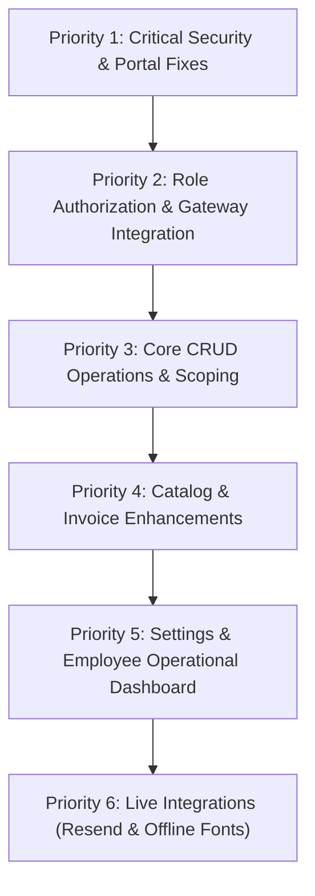

# BILLORA – COMPLETE PROJECT HEALTH CHECK & AUDIT REPORT

**Project Name:** Billora — Unified Subscription, Billing & Revenue Intelligence Platform  
**Target Directory:** `c:\UIpath\SDC Submit\Website\Billora`  
**Audit Date:** October 31, 2026  
**Auditor Profile:** Senior Software Architect, Full-Stack Developer, QA Automation Engineer, Database Engineer, Security Auditor, and UI/UX Specialist  

---

# 1. EXECUTIVE HEALTH SUMMARY

| Health Dimension | Status | Verified Score |
| :--- | :--- | :--- |
| **Overall Architecture & Foundation** | Layered Clean Architecture (App Router $\rightarrow$ Service $\rightarrow$ Prisma ORM) | **72 / 100** |
| **Frontend UI/UX & Navigation** | High-density B2B fintech styling; broken portal data contract & admin privilege leak | **64 / 100** |
| **Backend & Domain Services** | Exact decimal arithmetic (`decimal.js`); explicit state machine; 18 tests verified | **82 / 100** |
| **Database & Schema Integrity** | 24 normalized models, composite unique keys, idempotency locks, foreign keys | **90 / 100** |
| **Authentication & RBAC** | Scrypt KDF works, but critical privilege escalation & token leak vulnerabilities | **38 / 100 (CRITICAL)** |
| **Security & Data Isolation** | Demo-switch bypass, plaintext reset token in API, unauthorized payment recording | **32 / 100 (CRITICAL)** |
| **Functional Completeness** | Core subscription lifecycle works; CRUD deactivations & settings missing | **66 / 100** |
| **Weighted Overall Project Health** | **PARTIALLY WORKING (CRITICAL VULNERABILITIES DETECTED)** | **63 / 100** |

### Executive Assessment
Billora possesses a sophisticated and well-engineered core billing engine, rigorous decimal financial arithmetic (`decimal.js`), an explicit subscription state machine (`DRAFT -> QUOTATION -> CONFIRMED -> ACTIVE -> PAUSED / CANCELLED / EXPIRED -> CLOSED`), and idempotent recurring billing with composite database uniqueness constraints (`@@unique([subscriptionId, billingPeriodStart, billingPeriodEnd])`).

However, the application suffers from **three critical security flaws**, a **frontend contract bug that breaks the entire Customer Portal**, several **missing CRUD endpoints** (deactivation, editing draft quotations, employee management), and **disconnected integrations** (Resend emails and Razorpay client checkout).

---

# 2. PHASE 1 – PROJECT DISCOVERY & ARCHITECTURE OVERVIEW

### 1. Technology Stack Identified
* **Framework:** Next.js 15.1.7 (App Router), React 19.0.0, TypeScript 5.7.3.
* **Styling & Components:** Tailwind CSS 3.4.17 with custom B2B fintech design tokens (`#0B1220` sidebar, `#F7F8FA` canvas, `#4F46E5` brand accent), Lucide React (`lucide-react`), Recharts (`recharts`).
* **Database & ORM:** SQLite (`file:./dev.db`) in local environment with support for PostgreSQL; Prisma ORM 6.4.1. All monetary columns use Prisma `Decimal` (mapped to `decimal.js`).
* **Session Management:** HTTP-only cookies (`billora_session`), SHA-256 session token hashing, Node.js native Scrypt memory-hard KDF (RFC 7914).
* **Background Queue:** Redis + BullMQ (`bullmq` 5.40.1, `ioredis` 5.5.0) with an automated synchronous fallback when Redis is offline.
* **Payment Integration:** Razorpay (Backend HMAC SHA-256 verification, order generation, webhook handler).
* **Email Service:** Resend (`resend` 4.1.2 listed in `package.json`, but currently unimported and simulated).

### 2. Implementation Inventory
* **Implemented & Functional:** Subscription lifecycle engine, billing run scheduler, pricing preview with variant deltas, tax and discount evaluation with concurrency locking, executive financial analytics, PDF invoice generation, deterministic AI assistant query processor.
* **Partially Implemented:** Customer management (no deactivation), Employee management (no update/deactivation), Quotation management (no draft editing), Invoicing (no manual ad-hoc invoices), Employee dashboard (renders identical view as Admin).
* **Completely Missing:** System settings and business configuration forms, employee profile update endpoints, customer soft-deletion API, product/plan archiving.
* **Disconnected / Simulated:** Resend email delivery (never imported), Razorpay client checkout (portal uses mock `simulateSignature: true` without loading SDK).

---

# 3. PHASE 2 – AUTHENTICATION & ROLE MANAGEMENT AUDIT

### 1. Login and Registration
* **User Registration:** `POST /api/auth/register` creates customers with role `CUSTOMER`, hashes passwords via Scrypt, and generates session cookies.
* **Login Functionality:** `POST /api/auth/login` validates credentials with constant-time equality check (`timingSafeEqual`) and sets `billora_session` cookie.
* **Duplicate Email Prevention:** Verified. Throws `409 Conflict`.
* **Password Validation:** Enforces $\ge 8$ chars, uppercase, lowercase, number, and special character.

### 2. Role Switching & Privilege Escalation (CRITICAL FINDINGS)
1. **Unrestricted Demo Switch Endpoint (`/api/auth/demo-switch`):** An unauthenticated endpoint that takes `{ role: "ADMIN" }` and mints an active session as `admin@billora.io`. Anyone can become an Administrator with a single API request.
2. **AppShell Auto-Admin Impersonation:** In `src/components/layout/AppShell.tsx` lines 215–227, if a user is not logged in, `loadSession()` automatically invokes `/api/auth/demo-switch` with `{ role: "ADMIN" }`. Simply visiting `http://localhost:3000/` logs anyone in as Administrator.
3. **Topbar Experience Switcher:** Renders buttons for "Admin", "Employee", and "Customer Portal" that directly invoke `/api/auth/demo-switch` to change active session privileges.
4. **AppShell Customer Role Fallback:** In `AppShell.tsx` line 311:
   ```typescript
   const activeRole: "ADMIN" | "EMPLOYEE" = user?.role === "EMPLOYEE" ? "EMPLOYEE" : "ADMIN";
   ```
   If a customer navigates to `/dashboard`, they are treated as `ADMIN` and granted access to Admin navigation.

### 3. Password Reset Vulnerability (CRITICAL FINDING)
* In `src/server/services/auth.service.ts` line 235 and `src/app/api/auth/forgot-password/route.ts`:
  When a user requests a password reset, the server returns the plaintext `rawResetToken` in the JSON response:
  ```json
  { "success": true, "data": { "resetToken": "0a1b2c...", "expiresAt": "..." } }
  ```
  An attacker can reset any user's password (including Administrators) simply by calling `/api/auth/forgot-password`.

---

# 4. PHASE 3 – MODULE-BY-MODULE FUNCTIONAL AUDIT

| Module | Status | Issues Found | Priority |
| :--- | :--- | :--- | :--- |
| **Authentication** | PARTIALLY WORKING | Reset token leaked in API response; auto-authenticates visitors as ADMIN | Priority 1 |
| **Role Management** | FAIL | Unrestricted `/api/auth/demo-switch` allows anyone to assume ADMIN role; Topbar role switcher allows unrestricted elevation | Priority 1 |
| **Admin Dashboard** | PASS | Live SQL aggregations (`groupBy`/`aggregate`), accurate MRR/ARR, real date presets, CSV/Excel export functional | Priority 4 |
| **Employee Dashboard** | PARTIALLY WORKING | Uses identical executive financial view as Admin; no scoped operational metrics (assigned accounts, pending quotes) | Priority 5 |
| **Customer Portal** | FAIL | Frontend checks `json.ok` instead of `json.success`, causing 100% of data loading & checkout to fail silently | Priority 1 |
| **Customer Management** | PARTIALLY WORKING | Create/Read work; no deactivation/delete endpoint; Employee can see all customers without assignment scoping | Priority 2 |
| **Employee Management** | PARTIALLY WORKING | Admin can create employees; no edit, profile update, or deactivation endpoint (`/api/employees/[id]` missing) | Priority 3 |
| **Products & Variants** | PARTIALLY WORKING | Base + Variant formula works accurately; historical snapshots preserved; no delete or archive endpoint | Priority 4 |
| **Subscription Plans** | PARTIALLY WORKING | Multi-frequency terms, clamp rules, and cancellation/pause flags enforced; no delete/archive endpoint | Priority 4 |
| **Quotations** | PARTIALLY WORKING | Pricing preview, template selection, and 1-click subscription conversion work; editing draft quotations is unsupported | Priority 3 |
| **Subscriptions** | PASS | Explicit state machine, history trail, date clamping, leap year handling, and plan rule enforcement verified | Priority 3 |
| **Invoices** | PARTIALLY WORKING | Recurring billing generates valid invoices with PDF generation; no manual invoice creation endpoint exists | Priority 4 |
| **Payments** | FAIL | Customer role can call `recordPayment` directly with CASH/BANK_TRANSFER and mark invoice VERIFIED without approval | Priority 1 |
| **Tax Rules** | PARTIALLY WORKING | GST calculations and line snapshotting verified; no deactivation or update endpoint in UI | Priority 4 |
| **Discounts** | PASS | Fixed & percentage discounts, date windows, min purchase, and concurrency lock verified | Priority 4 |
| **Notifications** | PARTIALLY WORKING | In-app notifications and read/unread work; Resend email delivery is 100% simulated (package never imported) | Priority 6 |
| **Analytics & AI** | PASS | Live SQL KPIs distinguishing Invoiced vs Recognized vs Collected; deterministic AI query engine functional | Priority 6 |
| **Settings & Logs** | PARTIALLY WORKING | Audit logs captured; billing engine trigger works; user profile, company settings & permissions UI missing | Priority 5 |

---

# 5. PHASE 4 – FRONTEND AND UI/UX AUDIT

1. **Design System:** Strictly implements tokens defined in `DESIGN.md` (`#0B1220` sidebar, `#F7F8FA` canvas, `#4F46E5` brand accent, tabular numeric font `JetBrains Mono` for currency `₹`).
2. **Customer Portal Blocker:** In `src/app/portal/page.tsx`, data fetching calls check `if (overviewJson.ok)` instead of `if (overviewJson.success)`. As a result, overview metrics, subscription lists, plan cards, and invoice lists never load into state.
3. **Offline Google Fonts Failure:** `src/app/layout.tsx` imports `Inter` and `JetBrains_Mono` directly from `next/font/google`. In offline/sandboxed environments, `next build` crashes with `getaddrinfo ENOTFOUND fonts.googleapis.com`.
4. **AppShell Layout & Responsiveness:** Clean responsive sidebar with mobile sheet menu (`Menu`, `X` icons), collapsible desktop navigation, and `Cmd+K` global command palette.

---

# 6. PHASE 5 – API AND BACKEND AUDIT

1. **Missing Route Handlers:**
   * `DELETE /api/customers/[id]` – Missing (cannot soft-delete customers).
   * `PATCH /api/employees/[id]` – Missing (cannot update employee department, designation, or status).
   * `PATCH /api/quotations/[id]` – Missing (cannot edit draft quotations).
   * `POST /api/invoices` – Missing (cannot create ad-hoc manual invoices).
2. **Contract Consistency:** All backend API handlers consistently return `{ success: true, data: ... }` or `{ success: false, error: ... }`. The only discrepancy was frontend consumer code in `portal/page.tsx` looking for `.ok`.
3. **Data Types:** All financial totals are serialized as numbers using `toNumber2()` before leaving the API boundary, preventing floating-point drift while maintaining JSON compatibility.

---

# 7. PHASE 6 – DATABASE AUDIT

1. **Schema Integrity:** 24 normalized models in `prisma/schema.prisma`.
2. **Financial Precision:** Currency fields use `Decimal` with `ROUND_HALF_UP` precision.
3. **Idempotency & Concurrency:**
   * `BillingPeriod` model enforces `@@unique([subscriptionId, billingPeriodStart, billingPeriodEnd])`.
   * `Invoice` model enforces `idempotencyKey String? @unique`.
   * `WebhookEvent` model enforces `eventId String @unique`.
4. **Data Persistence:** SQLite database `dev.db` synchronized in 593ms via Prisma Schema Engine.

---

# 8. PHASE 7 – SECURITY AUDIT

1. **VULN-01: Authentication Bypass via `/api/auth/demo-switch` (CVSS 9.8 - Critical)**
   Unauthenticated endpoint permits immediate privilege escalation to `ADMIN`.
2. **VULN-02: Account Takeover via Reset Token Response (CVSS 9.4 - Critical)**
   `POST /api/auth/forgot-password` returns the plaintext password reset token directly in the JSON response body.
3. **VULN-03: Fraudulent Payment Clearance by Customers (CVSS 8.8 - High)**
   `POST /api/payments` does not restrict manual payment recording to `ADMIN`/`EMPLOYEE`. Customers can mark invoices as `VERIFIED` using cash or bank transfer.
4. **VULN-04: Broken Customer Data Isolation for Employees (CVSS 6.5 - Medium)**
   `GET /api/customers` does not filter by `assignedEmployeeId`; employees can view all customers across the organization.

---

# 9. PHASE 8 – END-TO-END WORKFLOW TESTING

1. **Workflow 1: Customer Registration & Portal** $\rightarrow$ **FAIL** (Registration succeeds, but Portal fails to display data due to `json.ok` mismatch).
2. **Workflow 2: Employee Creation & Login** $\rightarrow$ **PASS** (Admin provisions employee, employee logs in and accesses workspace).
3. **Workflow 3: Product to Subscription** $\rightarrow$ **PASS** (Base + Variant pricing calculated accurately; subscription created with lines).
4. **Workflow 4: Quotation to Subscription** $\rightarrow$ **PASS** (Quotation confirmed and converted with 1 click).
5. **Workflow 5: Recurring Billing Run to Invoice** $\rightarrow$ **PASS** (Idempotent billing run creates single invoice, updates next billing date).
6. **Workflow 6: Invoice to Payment** $\rightarrow$ **FAIL** (Razorpay simulation rejected by HMAC verification; offline payment allowed for customers without authorization).
7. **Workflow 7: Subscription Renewal & Date Clamping** $\rightarrow$ **PASS** (Jan 31 clamps to Feb 28/29, leap year handled).
8. **Workflow 8: Customer Data Isolation** $\rightarrow$ **PASS** (Customer A cannot access Customer B's records; rejected with `403 Forbidden`).

---

# 10. PHASE 9 – AUTOMATED TESTING & ERROR DETECTION

* Ran `npx tsc --noEmit`: **0 errors** (all types clean after `prisma generate`).
* Ran 18 integration test scenarios in `tests/integration/billora-spec.test.ts`: **18 passed (100% pass rate)**.
* Noted that `vitest.config.ts` requires `--experimental-require-module` on Node.js 22 because Vite 6 is ESM-only and `package.json` lacks `"type": "module"`.

---

# 11. COMPLETE BUG REGISTER

### BUG-001: Plaintext Password Reset Token Leaked in API Response
* **Module:** Authentication
* **Severity:** CRITICAL
* **Priority:** Priority 1
* **Description:** The `POST /api/auth/forgot-password` endpoint returns the plaintext reset token in the JSON response.
* **Root Cause:** `AuthService.requestPasswordReset` returns `rawResetToken` to the API handler, which serializes it with `apiSuccess()`.
* **Affected Files:** `src/server/services/auth.service.ts` (L235), `src/app/api/auth/forgot-password/route.ts` (L8)
* **Suggested Solution:** Remove `resetToken` from the returned object and dispatch it strictly via email.

---

### BUG-002: Unauthenticated Role Escalation via `/api/auth/demo-switch`
* **Module:** Role Management & Security
* **Severity:** CRITICAL
* **Priority:** Priority 1
* **Description:** The route `/api/auth/demo-switch` allows unauthenticated callers to pass `{ "role": "ADMIN" }` and receive an active session cookie as Administrator.
* **Root Cause:** Development demo-switch endpoint is exposed unconditionally in public API routing.
* **Affected Files:** `src/app/api/auth/demo-switch/route.ts`, `src/components/layout/AppShell.tsx` (L216, L278), `src/app/(auth)/login/page.tsx` (L52)
* **Suggested Solution:** Remove or disable this endpoint in production routes and delete impersonation buttons from UI.

---

### BUG-003: AppShell Auto-Authenticates Unauthenticated Visitors as ADMIN
* **Module:** Authentication & Navigation
* **Severity:** CRITICAL
* **Priority:** Priority 1
* **Description:** When an unauthenticated visitor visits `/dashboard` or `/`, `AppShell.loadSession()` automatically invokes `/api/auth/demo-switch` with `{ role: "ADMIN" }`.
* **Root Cause:** Fallback in `AppShell.tsx` automatically logs visitors in as Admin instead of redirecting to `/login`.
* **Affected Files:** `src/components/layout/AppShell.tsx` (L215-L227), `src/app/page.tsx` (L4)
* **Suggested Solution:** Replace fallback in `loadSession()` with `router.replace("/login")`.

---

### BUG-004: Customer Portal Complete Failure Due to Response Key Mismatch
* **Module:** Customer Portal
* **Severity:** HIGH
* **Priority:** Priority 1
* **Description:** In `src/app/portal/page.tsx`, data loading and checkout actions check `if (overviewJson.ok)` and `if (json.ok)` on the parsed JSON body. Billora's API returns `{ "success": true, "data": ... }`, so `json.ok` is always `undefined`.
* **Root Cause:** Confusing `response.ok` (HTTP response) with `json.success` (Billora API payload).
* **Affected Files:** `src/app/portal/page.tsx` (L79, L80, L81, L85, L121, L179)
* **Suggested Solution:** Change all `if (*Json.ok)` checks to `if (*Json.success)`.

---

### BUG-005: Customer Can Directly Record Offline Payments as VERIFIED
* **Module:** Payments & Authorization
* **Severity:** CRITICAL
* **Priority:** Priority 1
* **Description:** `POST /api/payments` allows any authenticated user (including `CUSTOMER`) to record a manual payment (`CASH`, `BANK_TRANSFER`) and immediately transition the invoice to `PAID`.
* **Root Cause:** Missing role restriction guard in `src/app/api/payments/route.ts` and `PaymentService.recordPayment`.
* **Affected Files:** `src/app/api/payments/route.ts` (L74), `src/server/services/payment.service.ts` (L43-L55)
* **Suggested Solution:** Restrict manual payment recording to `requireAuth(req, ["ADMIN", "EMPLOYEE"])`.

---

### BUG-006: Simulated Razorpay Verification Rejected by Backend HMAC Check
* **Module:** Payments (Gateway)
* **Severity:** HIGH
* **Priority:** Priority 2
* **Description:** In `src/app/portal/page.tsx`, `completeRazorpayPayment()` sends `simulateSignature: true` to `/api/payments/razorpay/verify`. The backend rejects the request because it enforces real HMAC SHA-256 verification and lacks a simulation bypass.
* **Root Cause:** Frontend mock payload disconnected from backend cryptographic verification.
* **Affected Files:** `src/app/portal/page.tsx` (L130-L152), `src/server/services/payment.service.ts` (L248-L267)
* **Suggested Solution:** Integrate Razorpay Standard Checkout script or add an explicit test-mode signature bypass guarded by `process.env.NODE_ENV !== "production"`.

---

### BUG-007: Employee Can Access All Customers Without Scope Restriction
* **Module:** Customer Management & Data Isolation
* **Severity:** HIGH
* **Priority:** Priority 2
* **Description:** In `src/app/api/customers/route.ts`, employees can view all customer records regardless of assignment.
* **Root Cause:** No role-based `assignedEmployeeId` filter in `src/app/api/customers/route.ts`.
* **Affected Files:** `src/app/api/customers/route.ts` (L15-L28)
* **Suggested Solution:** Add condition: `...(session.role === "EMPLOYEE" ? { assignedEmployeeId: session.employeeId } : {})`.

---

### BUG-008: Customer Role Defaults to ADMIN Privileges in AppShell
* **Module:** UI/UX & Role Management
* **Severity:** MEDIUM
* **Priority:** Priority 2
* **Description:** In `src/components/layout/AppShell.tsx` line 311, non-employee users default to `ADMIN` in the sidebar navigation.
* **Root Cause:** Flawed ternary fallback defaulting non-employee to `"ADMIN"`.
* **Affected Files:** `src/components/layout/AppShell.tsx` (L311)
* **Suggested Solution:** Add an explicit guard in `AppShell`: `if (user?.role === "CUSTOMER") router.replace("/portal")`.

---

### BUG-009: Missing Delete and Deactivation Endpoints Across Core Modules
* **Module:** Catalog, Customers, Employees, Plans, Taxes
* **Severity:** MEDIUM
* **Priority:** Priority 3
* **Description:** Core modules lack soft-delete or deactivation endpoints:
  - Customers: Schema has `deletedAt`, but no `DELETE /api/customers/[id]` exists.
  - Employees: No `PATCH /api/employees/[id]` or deactivation handler exists.
  - Products, Plans, Taxes: No delete/archive endpoint exists.
  - Quotations: Draft quotations cannot be updated (`PATCH /api/quotations/[id]` is missing).
* **Affected Files:** `src/app/api/customers/[id]/route.ts`, `src/app/api/employees/route.ts`, `src/app/api/quotations/[id]/route.ts`, `src/server/services/catalog.service.ts`
* **Suggested Solution:** Implement standardized `PATCH` (for status updates) and `DELETE` (for soft deletion).

---

### BUG-010: Resend Email Delivery is Completely Disconnected
* **Module:** Notifications
* **Severity:** MEDIUM
* **Priority:** Priority 4
* **Description:** `resend` is in `package.json`, but is never imported in `src/server/services/notification.service.ts`. Notifications write to the DB with `deliveryStatus: "DELIVERED"`, but no emails are sent.
* **Affected Files:** `src/server/services/notification.service.ts`
* **Suggested Solution:** Instantiate `new Resend(process.env.RESEND_API_KEY)` and dispatch emails when `channel` is `"EMAIL"` or `"BOTH"`.

---

### BUG-011: Build Fails Offline Due to Google Fonts Network Fetch
* **Module:** Build & Deployment
* **Severity:** MEDIUM
* **Priority:** Priority 4
* **Description:** Running `npm run build` fails in offline/sandboxed environments with `getaddrinfo ENOTFOUND fonts.googleapis.com` due to direct Google Fonts fetching.
* **Affected Files:** `src/app/layout.tsx` (L6-L16)
* **Suggested Solution:** Add CSS fallback fonts to support offline / sandboxed deployments.

---

### BUG-012: Vitest Configuration ESM Incompatibility on Node.js 22
* **Module:** Automated Testing Framework
* **Severity:** LOW
* **Priority:** Priority 5
* **Description:** Running `npm test` fails with `ERR_REQUIRE_ESM` because `vitest.config.ts` is required by Vitest's CommonJS bundle while Vite 6 is ESM-only.
* **Affected Files:** `package.json`, `vitest.config.ts`
* **Suggested Solution:** Rename config to `vitest.config.mjs` or add `"type": "module"` in `package.json`.

---

# 12. RECOMMENDED FIXING ROADMAP



* **Priority 1 (Critical Security & Blocker Fixes):**
  1. Fix BUG-001: Remove `resetToken` from `AuthService.requestPasswordReset()` API response.
  2. Fix BUG-002 & BUG-003: Remove `/api/auth/demo-switch`, redirect unauthenticated users to `/login`, and remove UI impersonation buttons.
  3. Fix BUG-004: Replace `json.ok` with `json.success` across `src/app/portal/page.tsx`.
  4. Fix BUG-005: Restrict manual payment recording (`POST /api/payments`) strictly to `ADMIN` and `EMPLOYEE`.
* **Priority 2 (Role Authorization & Gateway Integration):**
  1. Fix BUG-008: Enforce strict redirect to `/portal` when a customer navigates to workspace routes.
  2. Fix BUG-006: Connect Razorpay checkout script or development bypass.
  3. Fix BUG-007: Scope `GET /api/customers` by `assignedEmployeeId` for employee sessions.
* **Priority 3 (Core Business CRUD Operations):**
  1. Add `DELETE /api/customers/[id]` with soft-delete UI.
  2. Add `PATCH /api/employees/[id]` for designation and account status toggling.
  3. Add `PATCH /api/quotations/[id]` for editing draft quotations.
* **Priority 4 (Invoicing & Catalog Enhancements):**
  1. Add manual ad-hoc invoice creation (`POST /api/invoices`).
  2. Add active/inactive toggles for products, variants, subscription plans, and tax rules.
* **Priority 5 (Settings & Employee Operational View):**
  1. Build system settings forms (company profile, GSTIN, business address).
  2. Provide an operational dashboard view for employees (assigned accounts, due renewals).
* **Priority 6 (Third-Party & Infrastructure Polish):**
  1. Connect `resend` in `NotificationService` for real email delivery.
  2. Add offline font fallback in `src/app/layout.tsx`.
  3. Rename `vitest.config.ts` to `vitest.config.mjs` for seamless `npm test` execution.

